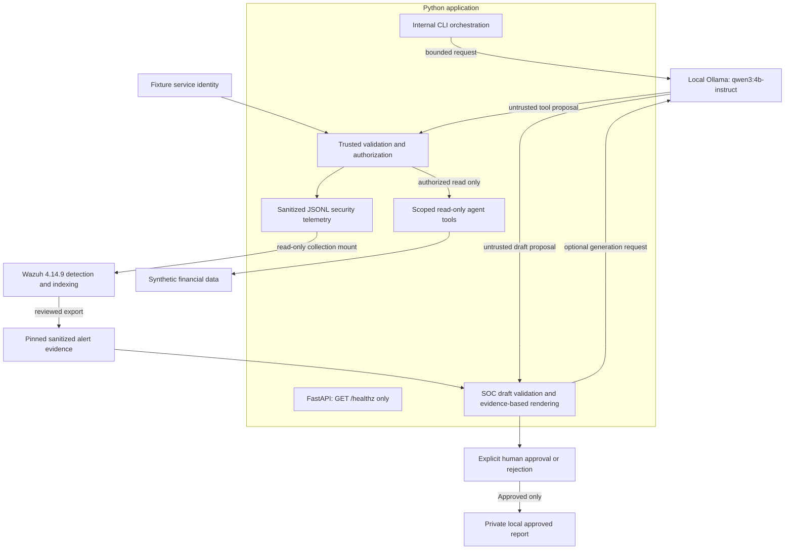

# AI Security Engineering Lab

An AI-assisted engineering lab demonstrating how trusted application controls constrain untrusted LLM proposals, protect synthetic financial data, and produce evidence for security investigations. All eight development milestones are complete for their documented lab scope. This is an educational portfolio project, not a production security platform or a claim of production SOC experience.

## What this project demonstrates

- **LLM and prompt injection security:** controlled lower-trust content experiments and strict model-output validation.
- **Synthetic financial data protection:** customer-scoped access enforced in Python, independently of prompts.
- **Agent authorization and restricted tools:** two read-only tools with bounded arguments/results and no autonomous chains.
- **Service identity boundaries:** trusted fixture identities with separate service permissions and customer scopes.
- **AI-specific telemetry:** structured authorization decisions without financial payloads, raw prompts, or model responses.
- **Wazuh detection engineering:** individual denial rules, same-service correlation, and verified indexed alerts.
- **CI/CD security automation:** offline regressions, dependency auditing, secret scanning, and read-only GitHub Actions; no deployment stage.
- **AI-assisted SOC investigations and human approval:** evidence-cited drafts that require an explicit trusted decision before local publication.

## Architecture



The diagram includes opt-in live inference paths; default CLI demonstrations use mocks. FastAPI is a separate health-only entry point; it exposes no inference, identity selection, financial data, tools, or SOC operations. Internal Python mediates every tool request. The model receives no direct data-store, shell, filesystem, credential, or Wazuh-administration access. SOC analysis consumes a reviewed snapshot, not a live autonomous SIEM connection.

## Demonstrated security scenarios

| Scenario | What the evidence establishes |
| --- | --- |
| Prompt injection in a financial document | The live control and injected phases both followed the legitimate task. No unauthorized request or successful model compromise was observed; that live run did not exercise authorization. |
| Cross-customer and tool abuse | Offline mocks assume malicious proposals; Python denies cross-customer access, unknown tools, identity overrides, and service-permission violations. |
| Incomplete model generation | A length-limited thinking-model response exposed a validation flaw; the client now requires `done=true` and `done_reason=stop`. |
| Detection engineering | Five fresh Python authorization denials became indexed Wazuh alerts. Repeated same-service failures triggered rule 100610 at level 10. Correlation expiration remains unverified. |
| Human review | The owner verified a live eight-section SOC draft citing E1–E5 and explicitly entered `APPROVE`; no autonomous remediation occurred. |

The opt-in vulnerable comparison is a **simulated outcome**, not an executed unauthorized data read. Passing authorization tests do not establish general model injection resistance.

## Verified results

- **406 application tests** and **13 CI-policy checks** passed; tests use offline model/network mocks.
- **Five indexed denial alerts:** rules `100602`, `100603`, `100604`, `100605`, and `100610`. Existing SSH rule `100001` remained functional.
- **GitHub Actions:** all three jobs passed in [run 41908231336](https://github.com/blackbird-git/ai-security-engineering-lab/actions/runs/41908231336): regressions, dependency audit/workflow policy, and secret scanning.
- **Live local inference:** owner-verified authorized tool execution and a separately approved SOC investigation. These are narrow observations, not reliability guarantees.

See the [evidence index and manual screenshot guidance](docs/portfolio-evidence.md). Structured evidence is published; private runtime reports and configuration are excluded.

## Reproduce the lab

From the repository root on Linux with Python 3.14, create an environment if needed and install the pinned requirements. Installation requires PyPI access; the following tests and default demos require neither Ollama nor Wazuh.

```bash
python3.14 -m venv .venv
.venv/bin/python -m pip install --no-deps -r requirements.txt
.venv/bin/python -m pip check
.venv/bin/python -m pytest -q
.venv/bin/python -m app.prompt_injection_demo
.venv/bin/python -m app.scoped_agent
.venv/bin/python -m app.telemetry_demo
.venv/bin/python -m app.soc_investigation
```

The default SOC command produces a Draft without saving an approved report. Use `--review` to inspect it and explicitly enter `APPROVE` or `REJECT`. Approved reports stay in ignored `local/investigations/approved/`.

For the diagnostic API only:

```bash
.venv/bin/python -m uvicorn app.main:app --host 127.0.0.1 --port 8000
```

`GET /healthz` returns `{"status":"ok"}`; Swagger, ReDoc, and OpenAPI routes are disabled. Keep loopback binding.

Detailed procedures: [optional local SOC inference and review](docs/soc-investigation.md), [prompt-injection experiment](docs/validation/milestone-04-prompt-injection-authorization.md), [Wazuh reproduction and rollback](integrations/wazuh/REPRODUCE.md), and [CI/scanner reproduction](docs/ci/security-pipeline.md). Wazuh deployment and live experiments require deliberate opt-in and the appropriate approval; no private owner configuration is needed from this repository.

## Investigations and validation

| Investigation | Supporting evidence |
| --- | --- |
| [001: Ollama generation truncation](docs/investigations/001-ollama-generation-truncation.md) | [Internal client validation](docs/validation/milestone-03-ollama-integration.md) |
| [002: Correlation expiration mismatch](docs/investigations/002-wazuh-correlation-expiry.md) | [Historical Phase B tests and rollback](docs/validation/milestone-06-phase-b-wazuh-rule-validation.md) |
| [003: Agent authorization detection](docs/investigations/003-ai-agent-authorization-detection.md) | [End-to-end Wazuh validation](docs/validation/milestone-06-end-to-end-wazuh-integration.md) and [sanitized indexed alerts](integrations/wazuh/evidence/2026-11-04-end-to-end-alerts.json) |

All eight milestones are complete for their recorded scope:

| # | Completed milestone | Record |
| --- | --- | --- |
| 1 | Scope and trust boundaries | [Accepted design](docs/security-decisions/ADR-0001-scope-and-trust-boundaries.md) |
| 2 | Health-only FastAPI baseline | [Validation](docs/validation/milestone-02-fastapi-baseline.md) |
| 3 | Internal local Ollama client | [Validation](docs/validation/milestone-03-ollama-integration.md) |
| 4 | Prompt injection and customer authorization | [Validation](docs/validation/milestone-04-prompt-injection-authorization.md) |
| 5 | Scoped agent tools and fixture identities | [Validation](docs/validation/milestone-05-scoped-agent-tools.md) |
| 6 | AI telemetry and Wazuh detections | [Validation](docs/validation/milestone-06-end-to-end-wazuh-integration.md) |
| 7 | GitHub Actions security pipeline | [Local validation](docs/validation/milestone-07-security-ci.md) and hosted run above |
| 8 | Human-reviewed SOC investigations | [Offline and owner-verified live validation](docs/validation/milestone-08-soc-investigation.md) |

## Security architecture decisions

All seven ADRs are Accepted for their documented scopes: [scope and trust boundaries](docs/security-decisions/ADR-0001-scope-and-trust-boundaries.md), [local inference](docs/security-decisions/ADR-0002-local-ollama-client.md), [synthetic data and authorization](docs/security-decisions/ADR-0003-synthetic-data-and-authorization.md), [scoped tools and identities](docs/security-decisions/ADR-0004-scoped-agent-tools.md), [telemetry and detection](docs/security-decisions/ADR-0005-security-telemetry.md), [security CI](docs/security-decisions/ADR-0006-security-ci.md), and [human-reviewed investigations](docs/security-decisions/ADR-0007-human-reviewed-investigations.md). [AGENTS.md](AGENTS.md) records engineering and safety standards.

## Known limitations

- Service and reviewer identities are lab fixtures, not production authentication. No authenticated reviewer service or tamper-resistant approval audit trail exists.
- Synthetic data/evidence only; SOC prose is rendered from controlled templates and validated references, not unrestricted model analysis. No autonomous remediation or production SOC integration.
- Correlation expiration is unverified; dashboard UI was not inspected. The telemetry file stops at 1 MiB; supervised rotation and automated report retention remain pending.
- Local Ollama clients are unauthenticated. The 128-token cap can truncate drafts; timeouts are not absolute deadlines. Live successes do not establish general attack resistance.
- Events/reports are unsigned and local host/application code is trusted. The evidence fingerprint checks one reviewed artifact, not independent provenance.
- Dependency pins lack hashes; runner images and Python patch versions can change. Scanning is point-in-time and cannot find every secret or vulnerability. PR/manual-trigger behavior and required-check settings remain unverified.
- Existing Starlette/HTTPX deprecation warning and sandbox TestClient hang remain documented. [Publication review](docs/publication-security-review.md) records accepted author-metadata disclosure, retained reproduction metadata, and review limits.

## Technology stack

Python 3.14 · FastAPI/Uvicorn · HTTPX · pytest · local Ollama (`qwen3:4b-instruct`; `qwen3:4b` retained for experiments) · synthetic financial fixtures · JSONL telemetry · Wazuh 4.14.9 · Docker-based SIEM lab · GitHub Actions · PyPA pip-audit · Gitleaks · actionlint. Exact Python application and CI-tooling versions are pinned separately in [requirements.txt](requirements.txt) and [ci/requirements.txt](ci/requirements.txt).
